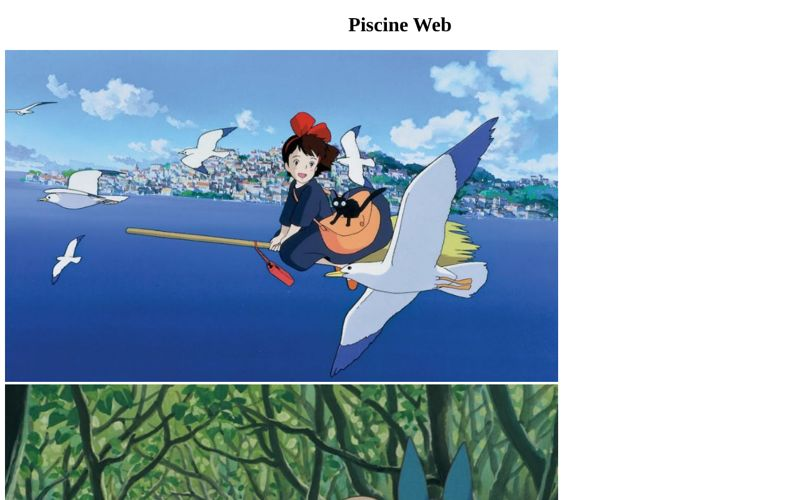
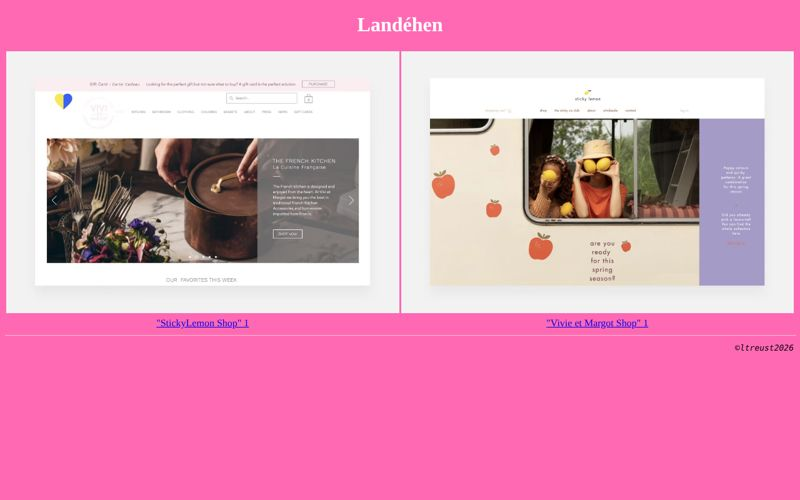
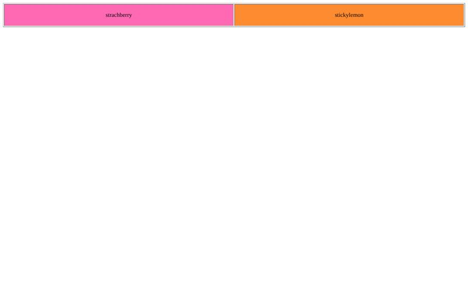
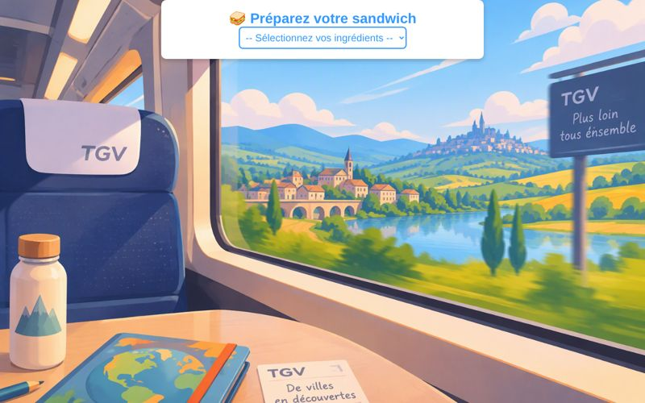
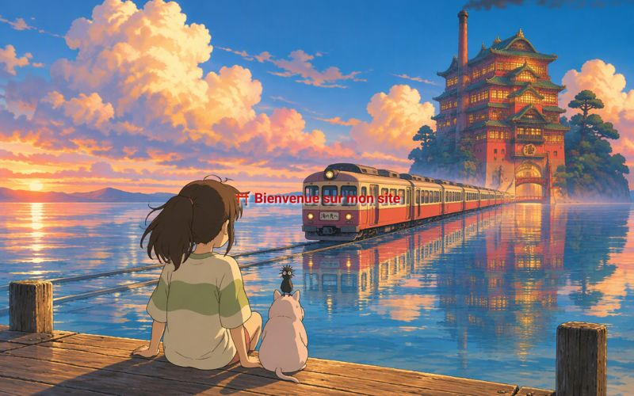
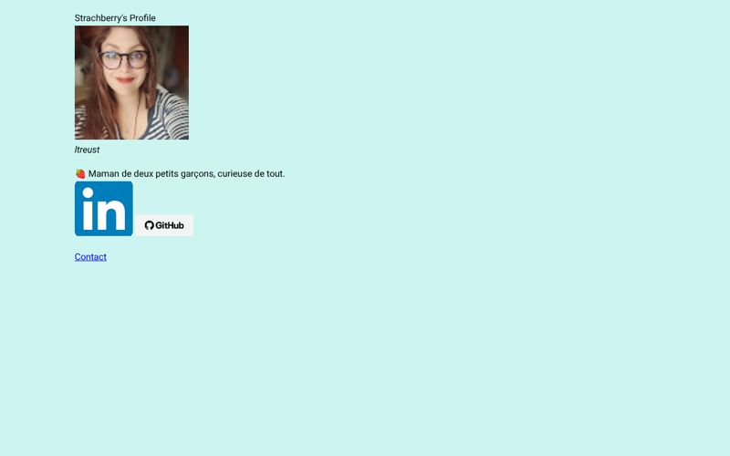
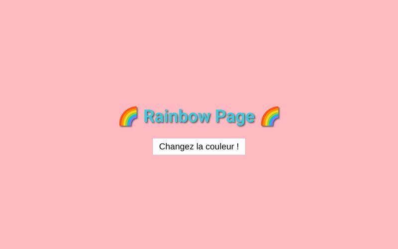
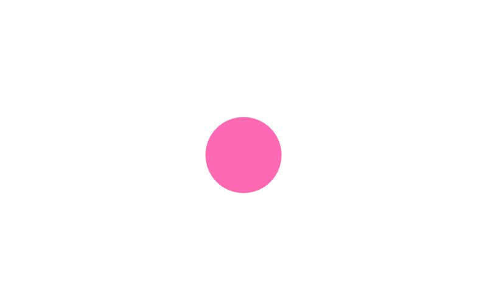

# 🍓 Ma semaine à l'école 42 : piscine Discovery

> 🍓 Maman de deux petits garçons, curieuse de tout. J'aime l'univers Ghibli, la nature et les animaux.

En novembre 2026, j'ai passé une semaine à l'école 42 pour découvrir le code.
Ce dépôt rassemble tout ce que j'ai construit, du terminal jusqu'aux pages web animées.

👉 **Voir la page de présentation :** https://strachberry13.github.io/Discovery_piscine/

## Mes projets

Cliquez sur le nom ou l'image d'un projet pour ouvrir la page en ligne, ou sur le dossier pour lire le code.

| Projet | Résultat (cliquez pour ouvrir) | Ce que j'ai appris | Fichiers |
|---|---|---|---|
| 🐚 Mes premiers scripts | — | Le terminal Linux, les scripts bash, les boucles | [`cell00`](discovery_piscine/cell00) |
| 👋 [Mes premières pages](https://strachberry13.github.io/Discovery_piscine/discovery_piscine/cell01/ex03/piscineweb.html) |  | Les bases du HTML : titres, images, liens | [`cell01`](discovery_piscine/cell01) |
| 🛍️ [B.A.B.A : mes boutiques](https://strachberry13.github.io/Discovery_piscine/discovery_piscine/cell01/ex04/baba.html) |  | Les tableaux et les images cliquables | [`cell01/ex04`](discovery_piscine/cell01/ex04) |
| 📱 [Une page qui s'adapte](https://strachberry13.github.io/Discovery_piscine/discovery_piscine/cell02/ex00/responsive.html) |  | Le responsive design | [`cell02/ex00`](discovery_piscine/cell02/ex00) |
| 🥪 [Prépare ton sandwich](https://strachberry13.github.io/Discovery_piscine/discovery_piscine/cell02/ex01/menu.html) |  | Les formulaires et les menus déroulants | [`cell02/ex01`](discovery_piscine/cell02/ex01) |
| 🏮 [Le Voyage de Chihiro](https://strachberry13.github.io/Discovery_piscine/discovery_piscine/cell02/ex02/parallax.html) |  | L'effet parallaxe et `position: sticky` | [`cell02/ex02`](discovery_piscine/cell02/ex02) |
| 🍓 [Ma carte de profil](https://strachberry13.github.io/Discovery_piscine/discovery_piscine/cell02/ex03/card.html) |  | Une carte de visite en HTML et CSS | [`cell02/ex03`](discovery_piscine/cell02/ex03) |
| 🌈 [Rainbow Page](https://strachberry13.github.io/Discovery_piscine/discovery_piscine/cell03/ex00/background.html) |  | Mon premier JavaScript : couleur au hasard au clic | [`cell03/ex00`](discovery_piscine/cell03/ex00) |
| 🎈 [Le ballon](https://strachberry13.github.io/Discovery_piscine/discovery_piscine/cell03/ex01/balloon.html) |  | Modifier le style d'un élément en JavaScript | [`cell03/ex01`](discovery_piscine/cell03/ex01) |
| 🏓 Pong (bonus) | — | Un jeu complet en JavaScript, [à jouer en ligne](https://strachberry13.github.io/PONG/) | [Strachberry13/PONG](https://github.com/Strachberry13/PONG) |

## Ce que j'ai appris

- **Le terminal** : naviguer, créer des fichiers et écrire des scripts bash
- **HTML** : construire une page avec des titres, des images, des liens, des tableaux et des formulaires
- **CSS** : la mise en page avec flex, les pages qui s'adaptent au téléphone et l'effet parallaxe
- **JavaScript** : réagir à un clic, tirer au hasard et changer les couleurs de la page
- **Et surtout** : que j'adore coder, et que c'est le début d'une nouvelle aventure 🌱

## Me retrouver

- 💼 [LinkedIn](https://fr.linkedin.com/in/lucie-treust-6a2254347)
- 💻 [GitHub](https://github.com/Strachberry13)
